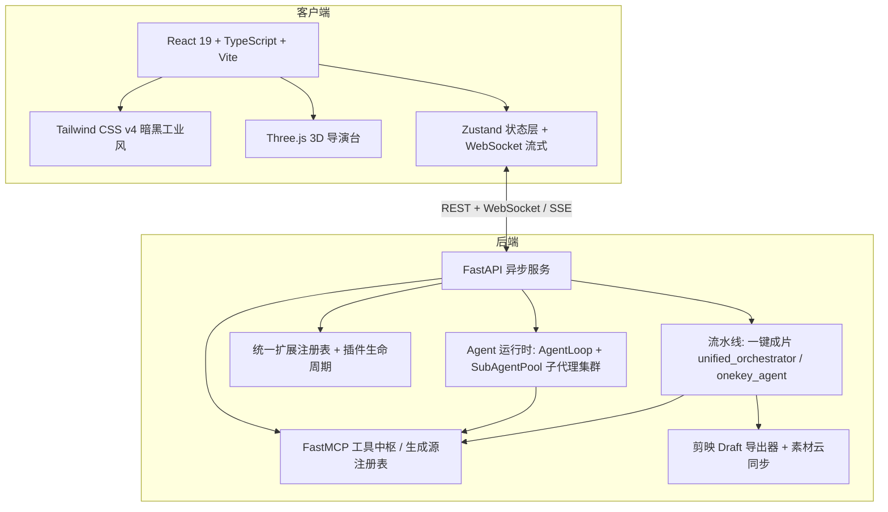

# MiniMax AI 漫剧 Studio（桌面 + 移动 双端工作台）

> 长篇小说 → 一键成片：**总导演 Agent + 专家子代理集群**并行编排（拆解 / 定妆 / 生图 / 图生视频 / 配音 / 导出剪映）。
> 内置 **3D 虚拟导演台**、多轨剪辑时间线、角色一致性资产库、**13 类插件扩展体系**（含自定义导演组），
> 并以 **MCP (Model Context Protocol)** 对外开放工具生态。

---

## 🌟 核心特性

### 1. 🎬 一键成片（两种编排引擎）
- **⚙️ 经典流水线**：固定 6 阶段确定性串行（拆解 → 角色定妆 → 逐镜生图 → 图生视频 → 配音 → 剪映导出），稳定可预期。
- **🤖 智能体集群**：总导演 Agent 规划 + 专家子代理**并行扇出**（同质任务批量 batch、长耗时视频后台提交 + `subagent_wait` 关键节点收口），
  单点失败不阻塞全片；前端实时花名册展示角色 / 批次 / 状态 / 耗时 / 当前工具。
- **导演组（可扩展编排）**：在弹窗选择导演组即切换成员名单与总导演编排脚本（playbook），
  支持 `qa_gate` 质检门（导出后强制质检员复核并汇总缺失镜头）。
- 产出直接落盘为正式项目并跳转分镜台，可继续逐镜微调。

### 2. 🖥️ 桌面专业版（Desktop Studio）
- **3D 虚拟导演台**：Three.js 实时渲染，角色素体 / 姿态预设 / 机位轨迹（推拉摇移、环绕、震颤），可同步为分镜运镜参数。
- **多轨音视频剪辑时间线**：主画面 / 对白 / 旁白 / BGM / 字幕多轨，帧级拖拽、缩放、吸附与音画对齐。
- **角色一致性资产库**：三视图（正面 / 侧面 / 3/4）管理，服饰与特征词锁定，跨镜复用。
- **桌面壳**：PyInstaller 独立包 + WebView2（pywebview，回退 Edge/Chrome App 模式），双击即用，无黑框。

### 3. 📱 移动端卡片流（Mobile）
- 整章粘贴 → 秒级拆解人物关系与分镜；9:16 全屏卡片流逐镜微调（换图 / 换声线 / 改台词 / 智能重绘）。

### 4. 🔌 插件与扩展体系（13 类扩展点）
- **统一扩展注册表**：生成源 / 技能 / 工作流 / 代码节点 / MCP 工具 / 画布节点 / 分镜槽 / 主题 / 导出器 / 导演包 / **导演组成员** / **导演组** / 插件包，
  扩展中心统一查看、启停（支持项目级软停用）、执行与健康观测。
- **插件包**：一个 zip 声明式带进全部扩展点；安装 → 启用（逐类落地）→ 禁用（精确回滚）→ 卸载，3 秒热重载。
- **导演组扩展**：自定义专家角色（系统提示 + 工具白名单 + 预算）与导演组编排（成员 + playbook + 质检门），
  插件贡献或直接落盘 `storage/agent_profiles|agent_teams/*.json` 即热生效。
  规范见 [`docs/plugin-dev.md`](docs/plugin-dev.md)（4.10 / 4.11 节），示例见 `plugins/example-drama-pack/`。

### 5. ☁️ 素材与工程云同步（OpenList）
- 本机 `storage/` 的素材与工程后台异步同步到 OpenList，换机打开即见项目列表；前端零改动（`/storage/xxx` 本地缺就去云端取）。
- 白名单同步（不涉 API Key 等配置），版本化快照 + 冲突保留；设置 →「素材与工程云端同步」可填自己的地址账号并测试联通。

### 6. 🔗 MCP 统一工具生态
- 内置 MCP 中枢：小说拆解、MiniMax 语音、3D 运镜规划、ComfyUI 桥接、剪映草稿导出等；
- 支持接入外部 MCP Server，自定义工具在 Agent 会话中可被直接调用。

---

## 🛠️ 技术栈架构



---

## 🚀 快速启动

### 方式一：Windows 桌面版（推荐给最终用户）
- 双击发布包内的 **`Studio.exe`**（或同目录 **`一键启动.bat`**），几秒后自动打开工作台。
- 使用说明见 [`使用说明.md`](使用说明.md)；首次使用在「设置 → 生成源」填 API Key 并点「测试」。

### 方式二：源码运行（开发）
```bash
# 1) 启动后端
cd server
python run_server.py            # http://127.0.0.1:8000 （文档 /docs）

# 2) 启动前端
cd client
npm install
npm run dev                     # http://localhost:5173
```

### 打包桌面 exe（一键全量构建）
```powershell
python build_release.py         # 前端构建 + PyInstaller → dist\Studio\Studio.exe（保留用户配置）
python build_release.py --release   # 干净发布包 → dist\AI漫剧Studio_0.1.0（剔除 Key/数据，附使用说明）
```

### 回归与检查
```bash
cd server && python -m unittest discover -s tests -p "test_*.py"   # 后端全量用例
cd client && npx tsc -b && npm run lint && npm run build           # 前端类型 / 规范 / 构建
```

---

## 📂 项目工程目录

```text
d:/ai漫剧/
├── client/                              # 前端（React 19 + Vite + TS + Tailwind v4 + Three.js + Zustand）
│   └── src/
│       ├── components/
│       │   ├── agent/                   # Agent 会话 / 集群面板 / 工具步骤卡（子代理可视化）
│       │   ├── director3d/              # 3D 虚拟导演台
│       │   ├── timeline/                # 多轨剪辑时间线
│       │   ├── storyboard/              # 分镜工作台与参数检查器
│       │   ├── workflow/                # 一键成片弹窗 / 工作流检查器
│       │   ├── skills/ mcp/ export/ character/ mobile/ ...
│       ├── services/ stores/ views/     # API 层 / 状态层 / 页面（含设置·扩展中心）
├── server/                              # 后端（FastAPI + FastMCP）
│   └── app/
│       ├── agent/                       # Agent 运行时（loop / manager / subagent 集群 / 工具管线 / trace）
│       ├── agent_teams/                 # 导演组扩展（角色画像 + 导演组编排 + 校验/热加载）
│       ├── api/                         # REST/WS 路由（onekey_routes / agent_team_routes / extension_routes ...）
│       ├── extensions/                  # 统一扩展注册表（13 kind 聚合 / 启停 / guard 审计 / 遥测）
│       ├── plugins/                     # 插件生命周期（安装 / 启用 / 精确回滚 / 热重载）
│       ├── pipelines/                   # 一键成片（unified_orchestrator / onekey_agent 草稿与原子工具）
│       ├── providers/                   # 生成源（图像 / 视频 / 音频[含 IndexTTS] / 素材）
│       ├── director_packs/ themes/ exporters/ canvas_nodes/ custom_nodes/ storyboard/ skills/ mcp/
│       ├── storage_sync/                # 素材与工程云同步（OpenList 镜像）
│       └── main.py                      # 应用入口与路由挂载
├── plugins/example-drama-pack/          # 示例插件包（技能/代码节点/画布节点/主题/导演包/导演组成员/导演组）
├── docs/plugin-dev.md                   # 插件开发规范（扩展点 / manifest / 生命周期 / API）
├── storage/                             # 运行时数据（项目 / 素材 / 配置 / 插件 / 扩展状态）
├── build_release.py                     # 一键全量构建（前端 + PyInstaller + 配置保留）
├── dist/Studio/Studio.exe               # 桌面产物（onedir）
├── 使用说明.md                           # 发布包用户手册
└── README.md
```

---

## 📚 相关文档

| 文档 | 内容 |
|---|---|
| [`docs/plugin-dev.md`](docs/plugin-dev.md) | 插件开发规范：13 类扩展点详解、manifest 字段、生命周期与热重载、统一执行口、HTTP API、安全模型 |
| [`使用说明.md`](使用说明.md) | 发布包安装与配置（用户向） |
| [`docs/`](docs/) | 各阶段设计文档与未落地清单 |
