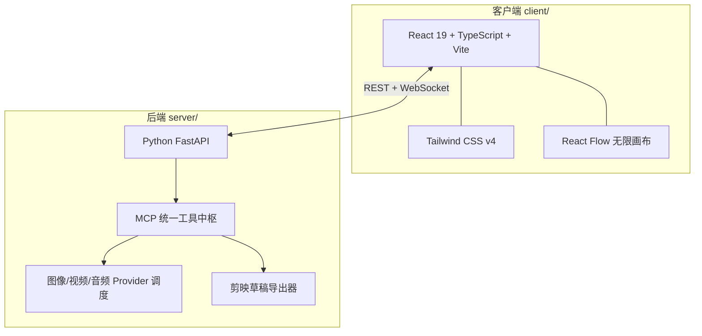

# AI 漫剧 Studio · 精简新手版 (multi_ai_simpleuse)

> 基于 AI 漫剧工作台项目裁剪而来的**简化新手版本**：保留核心创作流程，去掉进阶/实验性功能，让新机器和新用户拉下来就能跑、界面上少一半看不懂的东西。
>
> **上游完整版**：https://gitcode.com/dwq147/src （功能更全，进阶用户请移步）

---

## ⚠️ 本仓库是什么

- 这是一个**面向新手和轻量使用的精简版**，不是完整版。
- 相比上游 `dwq147/src`，**裁掉了部分功能**（见下方清单），未跟随上游 `master` 合并。
- 分支说明：本仓库 `master` 已同步推送为上游的 `multi_ai_simpleuse` 分支。
- 精简版保持了独立演进：包含上游没有的多项修复与重构（开发环境回源统一、视频任务轮询收敛、画布选中态修复、LLM 规划超时护栏、悬空素材清理等）。

### 与上游完整版相比，本版本裁掉的功能

| 裁掉的功能 | 说明 |
| --- | --- |
| 导演组扩展系统 | `agent_profile` / `agent_team`：插件贡献、热加载、编排脚本、质检门 |
| 子代理集群与一键成片 Agent 引擎 | 同步/异步/批量子代理调度 + `wait` 收口，集群可视化视图 |
| Agent 模式双维拆分与配置中心重构 | 上游重构后的 Agent 执行方式体系 |
| 导演台多机位与白模参考自动装配 | 3D 导演台的多机位编排新特性 |
| IndexTTS 内置配音通道 | 设置页填地址即用的本地 TTS 通道（本版本仅保留云端 TTS） |
| 启动器黑屏自愈等桌面端增强 | 构建更新后分片 404 自愈、Edge 独立 profile 等 |
| 上游的 README / 使用说明重写 | 本仓库 README 为精简版自行维护 |

> 需要以上任何功能，请使用上游完整版：https://gitcode.com/dwq147/src

### 精简版保留并增强的核心能力

- **无限画布（Creative Canvas）**：节点式创作流，图像/视频/音频/Comfy 工作流/分镜卡等节点自由连线，节点 Agent 控制台"说人话"生成。
- **生成源（Provider）体系**：内置与自定义生成源统一管理，支持把密钥从代码内联迁移到配置存储；设置页明确提示"填了是否生效"。
- **素材库**：人物/场景/道具等分类素材管理与拖拽上画布；悬空素材（文件已删、记录还在）一键清理，删除前自动备份清单。
- **素材与工程云同步（OpenList）**：素材与工程异步同步到 OpenList，换台机器还是同一套。
- **多轨时间线 / 分镜工作台 / 角色工坊 / 移动端卡片流 / 剪映草稿导出**：与主项目一致的基础创作链路。
- **MCP 工具中枢**：统一的 Model Context Protocol 工具注册与调用，画布节点可被 Agent 读写（键名自动驼峰→snake_case 归一）。

---

## 🛠️ 技术栈



> 桌面打包基于 Python（PyInstaller），仓库内的 `.spec` 与 `launch_desktop_app.py` 负责无黑框启动。

---

## 🚀 快速启动

### 方式一：Windows 一键启动（推荐）

双击根目录 **`一键启动.bat`**（或 `start_all.bat`）。已打包过 `dist/Studio` 的话会直接拉起桌面版。

### 方式二：开发模式分步启动

```bash
# 1. 后端（http://127.0.0.1:8000 ，API 文档 /docs）
cd server
python run_server.py

# 2. 前端（http://localhost:5173 ，与 51xx 段端口均可用）
cd client
npm run dev
```

### 双端开发模式

`一键启动(双端开发模式).bat` 同时拉起前后端热更新环境。

> 首次使用请在 **系统设置** 里配置各生成源（图像/视频/语音）的 API Key。密钥支持写入配置存储，避免明文散落在自定义生成源代码里。

---

## 📂 项目结构

```text
├── client/                 # 前端 (React 19 + Vite + Tailwind + React Flow)
│   └── src/
│       ├── components/
│       │   ├── canvas/     # 无限画布：节点、Agent 控制台、控制条
│       │   ├── asset/      # 素材库与素材选择器
│       │   ├── timeline/   # 多轨时间线
│       │   ├── storyboard/ # 分镜工作台与镜头检查器
│       │   ├── character/  # 角色工坊
│       │   ├── mobile/     # 移动端卡片流
│       │   ├── mcp/        # MCP 工具管理
│       │   └── export/     # 剪映草稿/成片导出
│       ├── services/       # API 通信层
│       ├── stores/         # Zustand 状态
│       └── utils/          # devOrigin（回源统一）/ videoTask（轮询统一）等
├── server/                 # 后端 (FastAPI + MCP)
│   └── app/
│       ├── api/            # REST 路由（素材、工程、画布…）
│       ├── canvas/         # 画布引擎与 Agent 规划
│       ├── mcp/            # MCP 工具注册中枢
│       ├── providers/      # 生成源管理（含自定义内联源沙盒）
│       └── pipelines/      # TTS / 一致性等流水线
├── storage/                # 运行时数据（工程、画布、素材、提供方索引）
├── plugins/                # 插件目录
├── exports/                # 成片/导出产物
├── 一键启动.bat             # Windows 一键启动
└── 使用说明.md              # 通俗版使用手册（新手从这里开始）
```

---

## 📚 更多文档

- `使用说明.md`：面向新手的操作手册
- `docs/`：同步说明、链路测试与优化计划等开发文档
- 上游完整版：https://gitcode.com/dwq147/src
