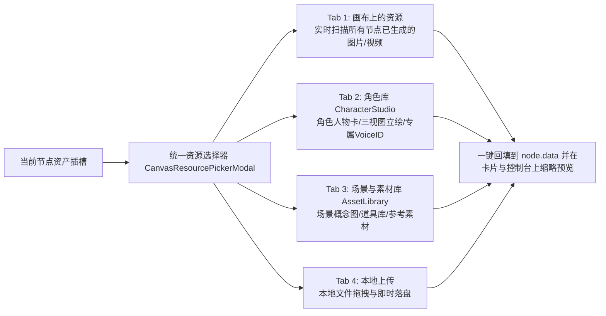

# 智能体无限画布（Agentic Studio Canvas）架构设计与实施方案

> **文件归属**：AI 漫剧 Studio 根目录设计规范文档  
> **版本**：v2.0 (Agentic & Dynamic-Provider Native)  
> **核心目标**：彻底解决传统“表单堆积式节点流”的痛点，将画布节点全面升级为**有大脑、有角色、挂载动态 MCP 技能的智能体容器**，并与系统现有的**动态生成源（ProviderDefinition）、ComfyUI 工作流、角色库、3D导演台及剪映时间线**深度打通。

---

## 目录
1. [一、 核心问题剖析与设计哲学](#一-核心问题剖析与设计哲学)
2. [二、 系统现有能力底座全景（立足实际）](#二-系统现有能力底座全景立足实际)
3. [三、 智能体无限画布全景架构](#三-智能体无限画布全景架构)
4. [四、 Agent 节点与动态生成源的深度绑定机制](#四-agent-节点与动态生成源的深度绑定机制)
5. [五、 四合一多模态资产上下文装载池 (Universal Context Loader)](#五-四合一多模态资产上下文装载池-universal-context-loader)
6. [六、 双模调度：用户自主点选 VS 智能体自主编排](#六-双模调度用户自主点选-vs-智能体自主编排)
7. [七、 前后端技术落地规范与代码映射](#七-前后端技术落地规范与代码映射)
8. [八、 验证指标与实施清单](#八-验证指标与实施清单)

---

## 一、 核心问题剖析与设计哲学

### 1.1 传统节点图 vs 现代智能体画布

| 维度 | 传统表单式节点图 (Legacy Flow) | 现代智能体画布 (Agentic Studio Canvas) |
| :--- | :--- | :--- |
| **卡片定位** | 死板的参数输入器（卡片内塞满 Textarea、Select、Number 滑块） | **沉浸式内容容器**（90% 区域用于大图矩阵、高清视频播放器、剧本排版、音频波形） |
| **生成源绑定** | 在卡片内部写死引擎或死板下拉 | **动态生成源元数据驱动**（从 `ProviderDefinition` 动态读取 `input_schema` 和 `params_schema`） |
| **参数输入方式** | 分散在各个节点内部，来回点击翻找 | **底部悬浮智能控制台**（与选中节点双向联动，集中控制 Prompt、模型与动态参数） |
| **多模态数据流转** | 只能靠节点左右细小的 Port 连线，极易混乱 | **三重上下文装载**（连线自动拓扑流转 + 画布产出池就地拾取 + 项目角色/素材库一键绑定） |
| **调用模式** | 仅支持人肉配置每一个参数 | **双模驱动**（既支持人肉自选源与参数，也支持大白话让 Agent 自主选择最优源并调度执行） |

### 1.2 核心设计哲学

```
┌──────────────────────────────────────────────────────────────────────────────────────────┐
│                                 Agentic Canvas 核心公式                                  │
├──────────────────────────────────────────────────────────────────────────────────────────┤
│                                                                                          │
│   Agent 节点  =  内容沉浸外壳 (Content-First Shell)                                       │
│               +  动态生成源绑定 (Active Provider Definition)                             │
│               +  多模态参数插槽 (Input Schema Slots: 首帧/尾帧/参考图/角色/音色)          │
│               +  智能调度大脑 (LLM Intent & MCP Tool Dispatcher)                         │
│                                                                                          │
└──────────────────────────────────────────────────────────────────────────────────────────┘
```

1. **去表单化与内容优先（Content-Centric）**：
   节点卡片本身不放复杂的表单控件，只展示**最终生成的画面、视频播放器、角色对白音频与剧本**。一切输入与调节收敛到底部浮动控制台。
2. **生成源抽象为标准 MCP / Provider 技能**：
   系统内的任何生成通道（ComfyUI 本地工作流、云端视频 API、硅基流动 FLUX、ElevenLabs、CosyVoice、自定义 Python 沙盒代码源）均抽象为一等公民的 Provider，拥有标准的 `input_schema` 与 `params_schema`。
3. **资产就地提取与连续镜头流转**：
   画布上任意节点产出的画面，都能在下游节点中直接勾选作为**首帧、尾帧或参考图**，形成画面-视频-音效的连续漫剧创作流。

---

## 二、 系统现有能力底座全景（立足实际）

重构必须 100% 尊重并复用本系统已有的强大底层资产，绝不脱离实际：

```mermaid
graph TD
    subgraph 底层生成源注册中心 (Provider Registries)
        IR[image_registry<br/>ComfyUI / 硅基流动 / 通义 / OpenAI]
        VR[video_registry<br/>ComfyUI视频 / 云端视频 / 自定义源]
        AR[audio_registry<br/>MiniMax / ElevenLabs / CosyVoice / GPT-SoVITS]
        CR[custom_provider_manager<br/>Python代码沙盒源 / HTTP模板源]
    end

    subgraph 影视与漫剧特色引擎
        D3D[director_3d_stage<br/>3D虚拟片场/景别/运镜/焦段/站位]
        SA[script_agent<br/>小说长文拆解/场景分镜/台词提取]
        JY[pyjianyingdraft<br/>剪映草稿工程自动装配与导出]
    end

    subgraph 项目资产与一致性库
        Chars[CharacterStudio<br/>角色人物卡/三视图立绘/专属VoiceID]
        Assets[AssetLibrary<br/>场景概念图/道具库/参考素材]
    end

    IR & VR & AR & CR & D3D & SA & JY --> MCP[FastMCP & MCPRegistry 统一技能网格]
    Chars & Assets --> Context[统一多模态上下文装载池]
    MCP & Context --> Canvas[智能体无限画布 Agentic Canvas]
```

---

## 三、 智能体无限画布全景架构

```
┌──────────────────────────────────────────────────────────────────────────────────────────┐
│                               智能体无限画布 5 层架构模型                                 │
├──────────────────────────────────────────────────────────────────────────────────────────┤
│                                                                                          │
│  [1. 视图沉浸层 (Visual Layer)]                                                          │
│   • 文本/剧本 Agent 节点: 场景镜头对白富文本排版、快捷技能 Pills、字符统计                   │
│   • 分镜生图 Agent 节点: 高清概念图、垫图参考对比、角色一致性徽标                        │
│   • 动态视频 Agent 节点: 悬浮播放控制器、首尾帧预览指示器、时长标记                          │
│   • 配音/声音 Agent 节点: 角色台词对白气泡、音频播放器与波形展示                            │
│   • 3D 导演机位节点: 景别(特写/中景/全景)、运镜(推/拉/摇/移)、焦段标记                      │
│   • 剪辑导出节点: 剪映草稿一键配置与时间线聚合                                           │
│   • 空间操作: 卡片右侧悬浮 [+] 手柄，点击或拖拽快速向右拉线衍生下游分镜                     │
│                                                                                          │
│  [2. 动态控制层 (Floating Control Layer)]                                                │
│   • 底部悬浮控制台 (FloatingAgentPromptBar): 与当前选中的节点严格双向绑定                 │
│   • 动态生成源选择器 (Provider Selector): 实时拉取系统中当前启用的 Provider                 │
│   • 动态模型选择器 (Model Selector): 实时拉取所选 Provider 的 models 列表                   │
│   • 动态参数插槽 (Asset Slots): 基于 Provider.input_schema 渲染首尾帧/参考图/音频挂载槽     │
│   • 多行 Prompt 输入与 AI 润色: 支持自然语言指令、全屏展开编辑、一键提交生成 (↑)           │
│                                                                                          │
│  [3. 上下文装载层 (Universal Context Loader)]                                            │
│   • 资产选择器弹窗 (CanvasResourcePickerModal) 提供 4 大真实数据源：                     │
│     ├── Tab 1: 画布上的资源 (实时扫描所有节点已生成的图片/视频)                           │
│     ├── Tab 2: 项目角色库 (CharacterStudio 角色头像、三视图立绘与 Voice ID)                │
│     ├── Tab 3: 场景与素材库 (AssetLibrary 场景图与道具)                                   │
│     └── Tab 4: 本地上传 (本地文件拖拽与即时上传)                                          │
│                                                                                          │
│  [4. 调度与协议层 (Dispatch & MCP Protocol)]                                             │
│   • 模式 A: 用户显式选择 Provider 与参数，直接提交执行                                   │
│   • 模式 B: 用户输入大白话，AI 导演 Agent 通过 MCP 工具自动匹配最优 Provider 并执行       │
│                                                                                          │
│  [5. 后端执行引擎层 (Execution & Engine Layer)]                                           │
│   • DAG 引擎 (engine.py): 拓扑排序、上游多模态句柄收集、_ensure_provider_registered 热装载   │
│   • 生成源沙盒 (CodeProvider / HttpProvider / ComfyUI / API Registry): 真实执行生成任务 │
│                                                                                          │
└──────────────────────────────────────────────────────────────────────────────────────────┘
```

---

## 四、 Agent 节点与动态生成源的深度绑定机制

### 4.1 生成源元数据模型（`ProviderDefinition`）

系统中的每个 Provider 具有如下规范：

```typescript
// 生成源定义模型
interface ProviderDefinition {
  id: string;                    // 如 'comfyui_flux', 'siliconflow_sd3', 'cloud_kling'
  name: string;                  // 显示名称，如 'ComfyUI 本地 FLUX'
  kind: 'image' | 'video' | 'audio' | 'llm';
  provider_type: 'comfyui' | 'http' | 'code' | 'local';
  models: string[];              // 支持的模型列表
  default_model?: string;
  
  // 动态输入插槽定义（含 x-handle 标注）
  input_schema?: {
    properties: {
      first_frame?: { type: 'string', format: 'uri', 'x-handle': 'first_frame', description: '首帧图' };
      last_frame?: { type: 'string', format: 'uri', 'x-handle': 'last_frame', description: '尾帧图' };
      reference_images?: { type: 'array', items: { format: 'uri' }, 'x-handle': 'reference_images', description: '参考图列表' };
      ref_audio?: { type: 'string', format: 'uri', 'x-handle': 'audio', description: '参考音频' };
      prompt?: { type: 'string', 'x-handle': 'text', description: '提示词' };
    };
  };

  // 动态参数控制定义
  params_schema?: {
    properties: {
      steps?: { type: 'integer', default: 20, description: '采样步数' };
      cfg?: { type: 'number', default: 7.5, description: '提示词引导系数' };
      duration?: { type: 'integer', enum: [3, 5, 7, 10], default: 5, description: '视频秒数' };
      aspect_ratio?: { type: 'string', enum: ['16:9', '9:16', '1:1'], default: '9:16' };
    };
  };
}
```

### 4.2 动态插槽解析流程

```
[用户在控制台选中某个 Provider]
        │
        ▼
[前端读取 provider.input_schema.properties]
        │
        ├── 发现 x-handle === 'first_frame'      ──> 渲染 [首帧] 挂载槽
        ├── 发现 x-handle === 'last_frame'       ──> 渲染 [尾帧] 挂载槽
        ├── 发现 x-handle === 'reference_images' ──> 渲染 [参考图] 挂载槽 (支持多选)
        └── 发现 x-handle === 'audio'            ──> 渲染 [参考音频] 挂载槽
```

---

## 五、 四合一多模态资产上下文装载池 (Universal Context Loader)

在画布上，当用户或 Agent 需要为某个插槽（如视频首帧、垫图参考、配音音色）绑定素材时，统一资源选择器提供 4 个层级的检索能力：



### 5.1 角色库一致性自动注入
- 当用户在选择器中选中【角色库】中的某个角色（如“李逍遥”）时：
  1. 角色头像/立绘 URL 自动填入当前插槽（如 `reference` 或 `first_frame`）；
  2. 角色的 `visual_prompt`（如 `少年剑客, 白衣长衫, 束发佩剑`）自动合并进 Prompt 输入框；
  3. 若节点为音频节点，角色的专属 `voice_id` 自动填入配音参数。

---

## 六、 双模调度：用户自主点选 VS 智能体自主编排

### 6.1 模式 A：用户自主点选（Manual Control Mode）
1. 用户在画布上点击节点使其处于选中态；
2. 底部控制台立即浮现，用户在下拉框中选择指定的 **生成源 Provider**（如 `ComfyUI 本地 FLUX 工作流`）；
3. 控制台动态展开该 Provider 所需的参数插槽与调节项；
4. 用户点击插槽上的 `+` 从“画布资源”或“角色库”中勾选参考图；
5. 输入提示词并点击 `↑` 触发生成。

### 6.2 模式 B：智能体自主编排（Agent Autonomous Mode）
1. 用户在 Prompt 框输入自然语言需求：
   > *“根据【李逍遥】角色卡，在客栈门口生成一张他拔剑的特写画面，然后用视频源生成一段 5 秒向前冲刺的镜头”*
2. 节点内的 Agent 识别意图，调用 MCP 工具 `canvas_dispatch_skill`：
   - 自动查询当前系统中已启用的 Provider 列表；
   - 自动读取角色库中【李逍遥】的特征与立绘；
   - 自动在画布上创建生图节点与视频节点，并完成连线与参数传递；
   - 自动触发 DAG 调度生成。

---

## 七、 前后端技术落地规范与代码映射

### 7.1 前端核心组件规范 (`client/src/components/canvas/`)

| 文件路径 | 职责与技术规范 |
| :--- | :--- |
| [`providerSkills.ts`](file:///d:/ai%E6%BC%AB%E5%89%A7/client/src/components/canvas/providerSkills.ts) | **动态生成源与技能适配器**：解析 `ProviderDefinition.input_schema` 提取插槽，定义高阶 Agentic 技能。 |
| [`FloatingAgentPromptBar.tsx`](file:///d:/ai%E6%BC%AB%E5%89%A7/client/src/components/canvas/FloatingAgentPromptBar.tsx) | **底部浮动智能控制台**：动态 Provider 下拉、动态模型选择、动态插槽缩略图展示、Prompt 多行输入与 AI 润色。 |
| [`CanvasResourcePickerModal.tsx`](file:///d:/ai%E6%BC%AB%E5%89%A7/client/src/components/canvas/CanvasResourcePickerModal.tsx) | **四合一多模态资产选择器**：画布产出 + 角色库立绘 + 素材库场景 + 本地上传。 |
| [`nodes/MinimalNodes.tsx`](file:///d:/ai%E6%BC%AB%E5%89%A7/client/src/components/canvas/nodes/MinimalNodes.tsx) | **纯净 Agent 节点卡片**：无表单、大图/播放器沉浸预览、Provider 徽标、右侧 `+` 快速衍生手柄。 |
| [`CreativeCanvas.tsx`](file:///d:/ai%E6%BC%AB%E5%89%A7/client/src/components/canvas/CreativeCanvas.tsx) | **画布主舞台**：状态同步、选区管理、衍生连线处理、DAG 与单节点执行分发。 |

### 7.2 后端核心模块规范 (`server/app/`)

| 文件路径 | 职责与技术规范 |
| :--- | :--- |
| [`canvas/engine.py`](file:///d:/ai%E6%BC%AB%E5%89%A7/server/app/canvas/engine.py) | **DAG 执行引擎**：拓扑排序、多模态句柄收集、`_ensure_provider_registered` 动态 Provider 即时热注册、单节点与完整流执行。 |
| [`api/canvas_routes.py`](file:///d:/ai%E6%BC%AB%E5%89%A7/server/app/api/canvas_routes.py) | **画布专用 API 路由**：`POST /canvas/execute`、`POST /canvas/node/execute`、`POST /canvas/dispatch-skill`、`GET /canvas/assets`。 |
| [`mcp/server.py`](file:///d:/ai%E6%BC%AB%E5%89%A7/server/app/mcp/server.py) | **MCP 协议服务端**：注册 `canvas_dispatch_skill`、`canvas_query_assets`、`canvas_create_node`、`canvas_connect` 等工具。 |
| [`providers/`](file:///d:/ai%E6%BC%AB%E5%89%A7/server/app/providers/) | **生成源底层实现**：`image_registry`、`video_registry`、`audio_registry`、`custom_provider_manager`。 |

---

## 八、 验证指标与实施清单

### 8.1 验证标准（Acceptance Criteria）
1. **真实生成源即创即用**：在系统中添加或导入一个 ComfyUI 工作流或自定义 Python 代码源后，画布控制台下拉框中能够即时出现该源，且节点能正常调度执行并产出结果。
2. **插槽动态自适应**：切换不同生成源时，底部控制台的挂载槽位根据其 `input_schema` 动态切换（例如从单图垫图自动变为首尾帧双插槽）。
3. **资产全链路就地流转**：分镜 A 节点生成的画面，能在分镜 B 节点中一键勾选为首帧或参考图，且全过程无需手动下载上传。
4. **角色一致性自动生效**：在选择器中挂载角色后，生成的图片/视频能准确保留角色的外貌特征与提示词描述。
5. **编译与打包 0 错误**：前端 `npm run build` 与后端 `python -m py_compile` 均保持 0 错误。

---

*本文档由 AI 漫剧 Studio 架构组制定，作为无限画布系统开发与重构的唯一标准执行方案。*
